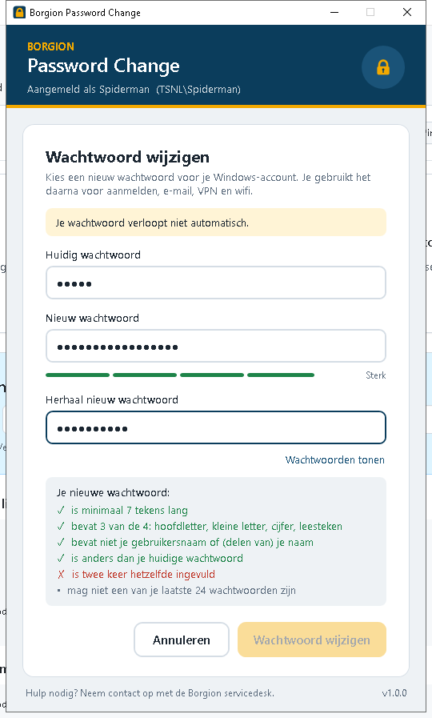

# Borgion Password Change

Kleine Windows-applicatie in Borgion-stijl waarmee **Active Directory-domeingebruikers zelf hun wachtwoord wijzigen**,
gewoon vanaf het bureaublad of het Startmenu. Geen beheerdersrechten, geen webportaal, geen extra server.



## Functies

- Wijzigt het wachtwoord van de **ingelogde domeingebruiker** rechtstreeks bij de domeincontroller.
- Leest het **wachtwoordbeleid van het domein** uit (minimale lengte, complexiteit, geschiedenis) en
  Fine-Grained Password Policies als de gebruiker die mag lezen.
- **Live checklist** terwijl je typt: lengte, 3 van 4 tekensoorten, geen (delen van) je naam, anders dan
  het huidige wachtwoord, twee keer gelijk. De knop wordt pas actief als alles klopt.
- Sterktemeter, Caps Lock-waarschuwing en "Wachtwoorden tonen".
- Laat zien **wanneer het huidige wachtwoord verloopt**.
- Duidelijke Nederlandse foutmeldingen (onjuist huidig wachtwoord, voldoet niet aan beleid, minimale
  wachtwoordleeftijd, account geblokkeerd, geen verbinding met het domein / VPN uit).
- Na het wijzigen: knop **Nu vergrendelen**, zodat de gebruiker ontgrendelt met het nieuwe wachtwoord en
  netwerkschijven, Outlook en Teams meteen de nieuwe inloggegevens gebruiken.
- Wachtwoorden worden nergens opgeslagen of gelogd en na gebruik uit het venster gewist.
- Draait op **.NET Framework 4.8** (standaard aanwezig in Windows 10/11): één klein `.exe`-bestand, niets extra's te installeren.

## Installeren

1. Download de nieuwste `BorgionPasswordChange-x.y.z.zip` via [Releases](../../releases) en pak hem uit.
2. Open PowerShell **als administrator** in die map:
   ```powershell
   powershell -ExecutionPolicy Bypass -File .\Installeren.ps1
   ```
   Alleen een Startmenu-snelkoppeling, geen bureaubladicoon:
   ```powershell
   powershell -ExecutionPolicy Bypass -File .\Installeren.ps1 -GeenBureaublad
   ```
3. De app staat in `C:\Program Files\Borgion\PasswordChange` met een snelkoppeling
   **Borgion Password Change** in het Startmenu en op het bureaublad van alle gebruikers.

Verwijderen: `Verwijderen.ps1` (als administrator).

### Uitrollen op meerdere werkplekken

- **GPO**: zet de uitgepakte map op een share (bijv. `\\domein\NETLOGON\BorgionPasswordChange`) en laat een
  computer-startupscript `Installeren.ps1` uitvoeren. Of kopieer de `.exe` met *Group Policy Preferences → Files*
  en maak de snelkoppeling met *Group Policy Preferences → Shortcuts*.
- **Intune / RMM**: verpak de map als Win32-app met installatieopdracht
  `powershell -ExecutionPolicy Bypass -File Installeren.ps1` en verwijderopdracht
  `powershell -ExecutionPolicy Bypass -File Verwijderen.ps1`. Detectie: bestand
  `C:\Program Files\Borgion\PasswordChange\BorgionPasswordChange.exe`.

## Instellingen

In `BorgionPasswordChange.exe.config` (naast de exe):

| Sleutel | Uitleg |
|---|---|
| `HelpdeskText` | Tekst onderaan het venster, bijv. telefoonnummer van de servicedesk. |
| `FallbackMinLength` | Minimale lengte die getoond wordt als het domeinbeleid niet uitgelezen kan worden. |

Het installatiescript overschrijft een bestaande (aangepaste) config niet.

## Vereisten

- Windows 10/11 (of Windows Server 2016+), lid van een Active Directory-domein.
- Gebruiker aangemeld met een **domeinaccount** en verbinding met een domeincontroller (op kantoor of via VPN).
- Het account mag het eigen wachtwoord wijzigen ("User cannot change password" staat uit) en de minimale
  wachtwoordleeftijd is verstreken.

## Hoe het werkt

De app zoekt de ingelogde gebruiker op via zijn SID met `System.DirectoryServices.AccountManagement` en roept
`UserPrincipal.ChangePassword(oud, nieuw)` aan. Dat is een gewone *wachtwoord wijzigen*-actie (geen reset), dus
het huidige wachtwoord is verplicht en het domeinbeleid inclusief wachtwoordgeschiedenis wordt door de
domeincontroller afgedwongen. De checklist in de app is alleen hulp vooraf; de domeincontroller beslist.

## Zelf bouwen

```powershell
dotnet build src -c Release
# uitvoer: src\bin\Release\net48\BorgionPasswordChange.exe
```

Het icoon opnieuw genereren: `powershell -ExecutionPolicy Bypass -File tools\Make-Icon.ps1`.

Bij elke push naar `main` bouwt GitHub Actions de app. Verhoog `<Version>` in
`src/BorgionPasswordChange.csproj` om automatisch een nieuwe release te maken.

## Licentie

MIT, zie [LICENSE](LICENSE).
